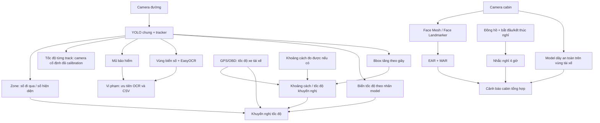

# Đối chiếu 12 chức năng Smart Traffic AI

## Kết luận

Dự án có đúng hướng tách camera đường và camera cabin, nhưng trước lần rà soát này các file mới chưa đồng nghĩa với chức năng đã hoạt động. Bản chạy `ai_engine/main.py` chỉ nối bốn chức năng cũ; backend có thêm module nhưng bị đứt dữ liệu ở vi phạm, mật độ, tốc độ và WebSocket.

Các lỗi triển khai dưới đây đã được sửa và kiểm thử bằng dữ liệu xác định. Chưa thể nghiệm thu độ chính xác nhận diện trên camera thật: trong workspace hiện có trọng số YOLO phương tiện và biển số, chưa có trọng số helmet, seatbelt, biển báo hoặc `face_landmarker.task`. Không tự tạo kết quả nhận diện khi thiếu model.

## Trạng thái từng chức năng sau sửa

| # | Chức năng | Triển khai và điều kiện chạy |
|---|---|---|
| 1 | Zone Counting | Có số đi qua cộng dồn, số hiện diện và số **xe** hiện diện riêng. Khuyến nghị tốc độ dùng số xe hiện diện; người đi bộ không làm tăng mật độ xe. |
| 2 | Biển số | Desktop và backend dùng cùng `PlateReader.process_tracks`: định vị một lần/frame, ghép track, lọc crop, bỏ phiếu OCR qua nhiều ảnh. Backend giữ bộ nhớ crop riêng cho mỗi kết nối. |
| 3 | Mũ bảo hiểm | Kiểm tra lại theo frame, nhận nhãn `helmet`/`no_helmet` từ detection chung hoặc model riêng. Thiếu bằng chứng trả `None`. Cần trọng số tương ứng; ghép người–xe vẫn là heuristic hình học. |
| 4 | Va chạm | Tốc độ tăng bbox được chuẩn hóa theo giây từ timestamp; vẫn là cảnh báo tương đối, không phải phép đo khoảng cách. |
| 5 | Tốc độ từng xe | Đã nối desktop/backend và trả `vehicles[].speed_kmh`. Chỉ trả km/h khi camera cố định được calibration. Timestamp stream dùng thời gian thực; video file dùng thời gian theo FPS. |
| 6 | Vi phạm mũ ↔ biển số | Sửa điều kiện khiến nhánh vi phạm không bao giờ chạy. Vi phạm ưu tiên OCR ngay trên crop đã ghép, lưu một hồ sơ/track trong bộ nhớ gần nhất, bổ sung biển số đến muộn vào dòng CSV cũ. Không ghi người đi bộ thành vi phạm xe máy. |
| 7 | Khoảng cách/tốc độ an toàn | Dùng tốc độ xe của tài xế từ telemetry, không dùng tốc độ trung bình xe trước hoặc giả định 50 km/h. Khoảng cách khuyến nghị và khoảng cách đo được là hai trường khác nhau. Tốc độ theo khoảng cách chỉ có khi cung cấp khoảng cách đo được. |
| 8 | Biển báo tốc độ | Đọc giá trị từ nhãn `speed_limit_50`, `speed_limit_80`… hoặc `SIGN_SPEED_LABELS`; hỗ trợ detection chung/model riêng. Vòng tròn đỏ chỉ là `unclassified_red_sign`, không suy đoán số trên biển. Cần model đã huấn luyện. |
| 9 | Khuyến nghị tốc độ | Kết hợp số xe hiện có, giới hạn biển gần nhất và dữ liệu an toàn; giữ được khuyến nghị 0 km/h. Web/mobile so sánh giá trị tốc độ, không so chuỗi lý do tiếng Anh với thông báo tiếng Việt. |
| 10 | Buồn ngủ | Có Face Mesh cũ và Face Landmarker Tasks mới khi có asset; trả trạng thái khả dụng. EAR/MAR, cửa sổ ngáp theo thời gian; mất mặt xóa chuỗi nhắm mắt liên tiếp. Cần kiểm chứng trên video cabin. |
| 11 | Dây an toàn | Camera cabin/model riêng, không phụ thuộc Face Mesh. Thiếu model/không nhận diện trả `seatbelt_on: null`; chỉ `false` mới cảnh báo và ghi vi phạm. Cần crop/góc camera chỉ tài xế và model đúng nhãn. |
| 12 | Nghỉ sau 4 giờ | Mặc định 240 phút, cảnh báo sớm theo cấu hình. Đồng hồ monotonic, tạm dừng khi nghỉ; nghỉ ngắn không cộng vào thời gian lái, nghỉ đủ mới reset. Có điều khiển nghỉ trên web và giữ timer khi reconnect cùng token. |

## Kiến trúc cần hiểu đúng



Điểm chỉnh so với sơ đồ đề xuất:

- Face Mesh cung cấp landmark khuôn mặt; không nhận diện dây an toàn trên ngực. Timer hoạt động độc lập, chỉ kết hợp kết quả với buồn ngủ ở bước tổng hợp cảnh báo.
- Camera cố định đo chuyển động phương tiện khác; dashcam di chuyển không thể lấy dịch chuyển pixel của xe khác làm tốc độ xe của tài xế.
- YOLO COCO không có sẵn toàn bộ lớp chuyên dụng. Đường chạy tương thích hiện tại dùng detector phương tiện chung cộng model biển số và các model chuyên dụng khi có. Muốn **đúng một YOLO cho nhóm A**, phải cung cấp model đa lớp phù hợp.

## Cấu hình và cách chạy

Trong `ai_engine/config.py`:

```python
# Camera cố định: tự đo tỷ lệ trên vùng theo dõi và độ phân giải đầu vào.
SPEED_CAMERA_MODE = "fixed"
SPEED_PIXELS_PER_METER = 10.0  # Ví dụ minh họa; không dùng khi chưa đo thực tế.

# Một YOLO duy nhất: chỉ bật sau khi đã có model huấn luyện đủ các lớp.
ROAD_MODEL_SHARED_CLASSES = True
VEHICLE_MODEL_PATH = "models/road_multiclass.pt"
# Nhãn: person, motorcycle/motorbike, car/truck/bus,
# helmet, no_helmet, license_plate, speed_limit_30 ... speed_limit_120.
```

Mặc định `SPEED_CAMERA_MODE="moving"`, `SPEED_PIXELS_PER_METER=None`, `ROAD_MODEL_SHARED_CLASSES=False`. Chế độ một model kiểm tra các nhãn bắt buộc khi khởi tạo; không tải thêm model định vị biển số, mũ hoặc biển báo. EasyOCR vẫn là model OCR riêng theo thiết kế. Chưa có trọng số `road_multiclass.pt` trong dự án.

Tỷ lệ pixel/mét chỉ phù hợp vùng có tỷ lệ gần đồng nhất. Góc phối cảnh mạnh cần calibration mặt đường/homography trước khi có thể dùng tốc độ trên toàn khung hình.

Chạy từ thư mục `ai_engine` trong môi trường đã cài đủ `requirements.txt`:

```powershell
python main.py --source sample_videos/traffic.mp4 --no-display --max-frames 100
# Tham số dưới đây chỉ dành cho demo video có tốc độ/khoảng cách đã biết:
python main.py --source sample_videos/traffic.mp4 --ego-speed 50 --distance 20
```

CSV được ghi riêng từng phiên ở `output/violations-<session>.csv`, mở được bằng Excel. Đây là đầu ra hồ sơ liên kết biển số của chức năng 6. Bảng DB hiện vẫn là nhật ký cảnh báo tổng quát; chưa đồng bộ đầy đủ vòng đời hồ sơ CSV vào DB.

Road WebSocket nhận metadata:

```json
{"type":"metadata","vehicle_speed":50,"estimated_distance_m":20}
```

`vehicle_speed` là tốc độ xe của tài xế, `estimated_distance_m` là khoảng cách đo được đến xe đang cảnh báo; không phải kích thước bbox. Không gửi dữ liệu giả để lấp trường thiếu. Khi nhiều xe cùng cảnh báo, cần nguồn đo xác định đúng đối tượng; API hiện chỉ hỗ trợ một khoảng cách đầu vào.

Cabin WebSocket `/ws/v1/driver-stream` nhận:

```json
{"type":"break_started"}
{"type":"break_ended"}
```

Server trả `driver_session` chứa token ngẫu nhiên để tiếp tục timer qua `?timer_token=...`. Web giữ token theo tab. Timer được giữ 24 giờ sau disconnect trong bộ nhớ tiến trình; restart backend, đổi worker hoặc mất token vẫn bắt đầu phiên mới. Không dùng cơ chế này làm bằng chứng tuân thủ thời gian lái xe thương mại. Ngưỡng nghỉ 15 phút là cấu hình ứng dụng, không phải kết luận pháp lý cho mọi loại xe.

Web có nút bắt đầu nghỉ/tiếp tục lái. Pipeline cabin và logic cảnh báo độc lập với trạng thái camera đường. Mobile hiện gửi camera đường; logic cảnh báo đã sẵn sàng nhận dữ liệu cabin nhưng chưa có luồng camera cabin đồng thời trên điện thoại.

## Những phần chưa được nghiệm thu

- Huấn luyện/đánh giá model mũ, biển báo, dây an toàn và model đa lớp dùng chung; không thể thay bằng việc tạo thêm file Python.
- Độ chính xác OCR, ghép người–xe và ID khi che khuất trên video thực tế; hồ sơ hiện phục vụ thử nghiệm, chưa có quy trình duyệt bằng chứng.
- Hiệu chuẩn tốc độ/phối cảnh, nguồn GPS/OBD và khoảng cách thực; các công thức khoảng cách là heuristic kỹ thuật, chưa tích hợp đầy đủ bối cảnh đường/xe/thời tiết/pháp lý.
- EAR hiện dùng ngưỡng số frame; cần đánh giá ở FPS cabin thực tế. Cảnh báo ngáp đã dùng cửa sổ thời gian.
- Chưa chạy E2E với camera, GPU, EasyOCR và PostgreSQL trong môi trường kiểm thử mới. Môi trường `venv` cũ trỏ tới Python 3.13 không truy cập được; `.venv` mới chỉ cài thư viện phục vụ kiểm thử xác định.

## Kiểm tra

Kết quả lần rà soát: **30 kiểm thử Python qua**, **14 kiểm tra logic cảnh báo web/mobile qua**, TypeScript của cả web và mobile qua; Python compile và `git diff --check` qua. Có một cảnh báo deprecation từ cách khai báo cấu hình Pydantic sẵn có. Các kết quả này kiểm chứng logic, không thay cho đánh giá model trên video thực.

```powershell
.venv/Scripts/python.exe -m pytest tests/unit/test_traffic_features.py tests/unit/test_plate_filter.py tests/unit/test_ui.py -q -p no:cacheprovider
node tests/unit/test_alert_engine.cjs
# Tại từng thư mục web-app và mobile-app:
node node_modules/typescript/bin/tsc --noEmit --incremental false
```

Kiểm thử bao phủ số hiện diện so với số cộng dồn; tốc độ theo timestamp và thiếu calibration; tốc độ bbox mỗi giây; ghép track có ứng viên thứ hai; vi phạm mũ/không xác định/người đi bộ; OCR đến muộn; đọc nhãn biển; một lượt định vị biển số chung; khoảng cách bằng 0; nghỉ ngắn/đủ/4 giờ; cabin không phụ thuộc road; timer reconnect; schema và pipeline backend bằng detector giả lập.

Nguồn kỹ thuật đối chiếu: [danh sách lớp COCO của Ultralytics](https://docs.ultralytics.com/datasets/detect/coco/), [Face Landmarker Python và asset bắt buộc](https://developers.google.com/edge/mediapipe/solutions/vision/face_landmarker/python).
