# 🎨 SỔ TAY TOÀN BỘ HÌNH ẢNH, SƠ ĐỒ & MÃ NGUỒN VẼ DIAGRAM (BÁO CÁO 90 TRANG)
## DỰ ÁN: HỆ THỐNG TRỢ LÝ LÁI XE THÔNG MINH VÀ GIÁM SÁT AN TOÀN ĐỘI XE — TRAFFICGUARD

> **TÀI LIỆU DÀNH CHO TÁC GIẢ BÁO CÁO ĐỒ ÁN / KHÓA LUẬN:**
> * Tất cả sơ đồ kiến trúc, luồng xử lý, sequence, ERD, máy trạng thái đều được cung cấp **MÃ NGUỒN MERMAID / DRAW.IO CHUẨN**. Bạn chỉ cần sao chép mã và dán vào [draw.io](https://app.diagrams.net/) (chọn *Arrange -> Insert -> Advanced -> Mermaid*) hoặc trang [mermaid.live](https://mermaid.live/) là xuất được ảnh SVG/PNG vector sắc nét 100%.
> * Tất cả hình ảnh chụp màn hình, ảnh crop AI đều đi kèm **QUY TẮC BỐ CỤC CHỐNG CHE KHUẤT (Non-Obscuring Annotation Guidelines)**: nhãn đặt bên ngoài vùng quan sát, đường dẫn mũi tên thanh mảnh, hộp thoại phụ trợ nằm ở góc thoáng, đảm bảo người đọc thấy rõ toàn cảnh đối tượng (xe, biển báo, biển số, mặt người).

---

## 📑 MỤC LỤC DANH MỤC HÌNH ẢNH (35 HÌNH TOÀN KHÓA LUẬN)

* [CHƯƠNG 1: TỔNG QUAN & BỐI CẢNH](#chương-1-tổng-quan--bối-cảnh) (Hình 1.1 -> 1.2)
* [CHƯƠNG 2: CƠ SỞ LÝ THUYẾT & CÔNG NGHỆ](#chương-2-cơ-sở-lý-thuyết--công-nghệ) (Hình 2.1 -> 2.7)
* [CHƯƠNG 3: PHÂN TÍCH YÊU CẦU & KIẾN TRÚC](#chương-3-phân-tích-yêu-cầu--kiến-trúc) (Hình 3.1 -> 3.4)
* [CHƯƠNG 4: 12 MODULE TRÍ TUỆ NHÂN TẠO (AI PIPELINE)](#chương-4-12-module-trí-tuệ-nhân-tạo-ai-pipeline) (Hình 4.1 -> 4.10)
* [CHƯƠNG 5: MÁY CHỦ BACKEND & CSDL FASTAPI](#chương-5-máy-chủ-backend--csdl-fastapi) (Hình 5.1 -> 5.5)
* [CHƯƠNG 6: GIAO DIỆN WEB DASHBOARD & MOBILE APP](#chương-6-giao-diện-web-dashboard--mobile-app) (Hình 6.1 -> 6.7)
* [CHƯƠNG 7: KIỂM THỬ, THỰC NGHIỆM & HIỆU NĂNG](#chương-7-kiểm-thử-thực-nghiệm--hiệu-năng) (Hình 7.1 -> 7.3)
* [CHƯƠNG 8: TRIỂN KHAI PRODUCTION & PHÁP LÝ](#chương-8-triển-khai-production--pháp-lý) (Hình 8.1 -> 8.2)

---

# CHI TIẾT TỪNG HÌNH ẢNH, SƠ ĐỒ VÀ MÃ DIAGRAM

---

## CHƯƠNG 1: TỔNG QUAN & BỐI CẢNH

### 🖼️ Hình 1.1: Sơ đồ Ma trận Định vị và So sánh Tính năng TrafficGuard với Thị trường
* **Vị trí trong báo cáo:** Mục 1.2 (Tổng quan các giải pháp trong và ngoài nước).
* **Mô tả nội dung:** Biểu đồ so sánh 3 trục hoặc dạng lưới định vị giải pháp: So sánh TrafficGuard với các giải pháp quốc tế đắt tiền (Mobileye, Samsara) và các giải pháp nội địa hiện hành (Camera Nghị định 10). Thể hiện rõ TrafficGuard tối ưu chi phí thấp nhưng có tính thời gian thực cao và chuyên biệt hóa cho giao thông Việt Nam.
* **Mã nguồn vẽ trên draw.io / Mermaid:**
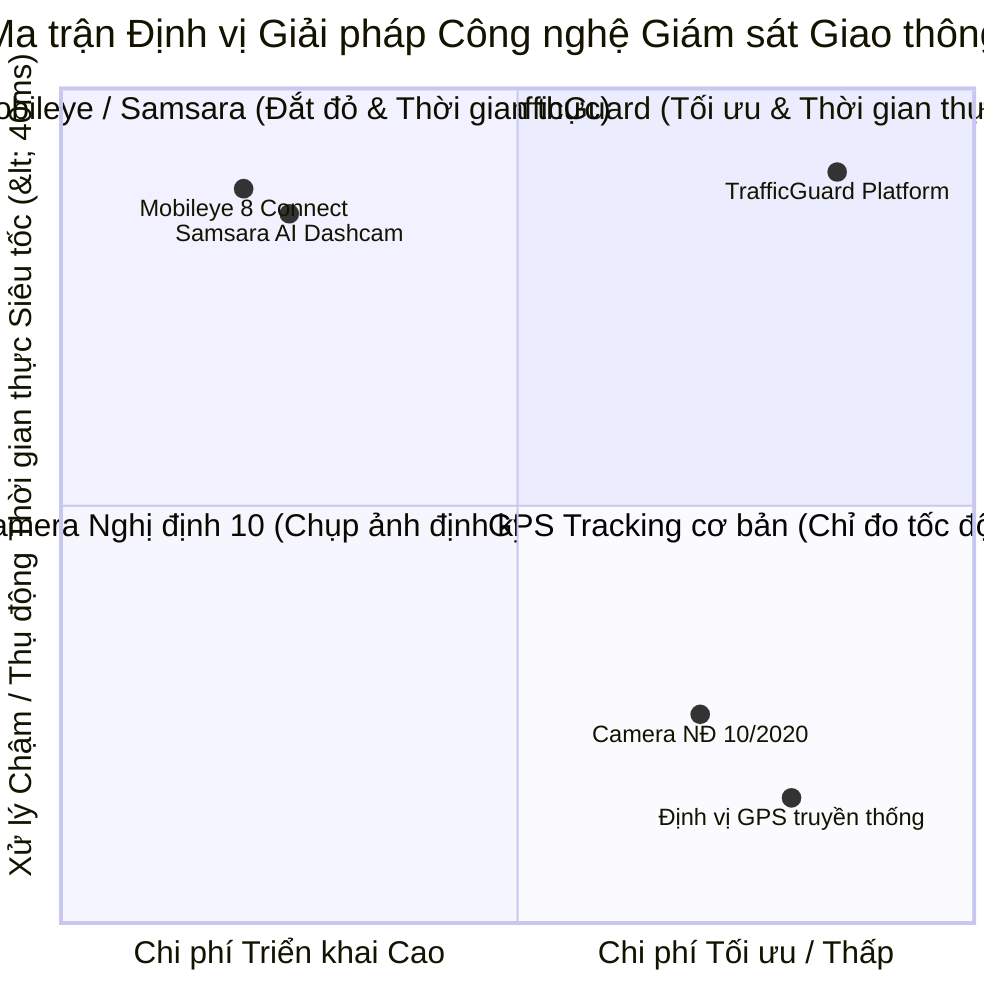
* **Quy tắc chú thích không che khuất:** Để nhãn điểm nằm bên phải các chấm tròn, giãn cách tối thiểu 15px so với các trục tọa độ.

---

### 🖼️ Hình 1.2: Sơ đồ Phương pháp luận Nghiên cứu và Lộ trình Triển khai Dự án
* **Vị trí trong báo cáo:** Mục 1.4 (Phương pháp tiếp cận nghiên cứu).
* **Mô tả nội dung:** Lưu đồ khối các giai đoạn: Khảo sát luật giao thông $\rightarrow$ Thu thập dữ liệu video $\rightarrow$ Huấn luyện mô hình AI $\rightarrow$ Xây dựng Backend/Frontend $\rightarrow$ Kiểm thử 90/90 bài test $\rightarrow$ Đóng gói triển khai.
* **Mã nguồn vẽ trên draw.io / Mermaid:**
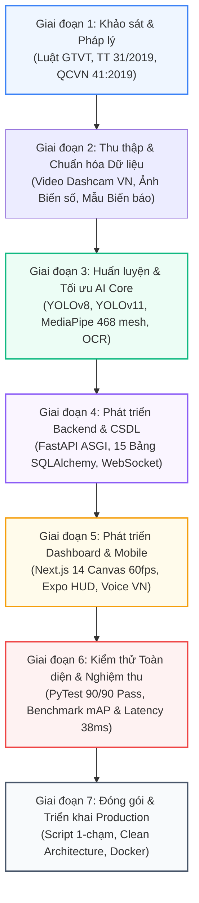

---

## CHƯƠNG 2: CƠ SỞ LÝ THUYẾT & CÔNG NGHỆ

### 🖼️ Hình 2.1: Kiến trúc Mạng Nơ-ron Phát hiện Vật thể YOLOv8
* **Vị trí trong báo cáo:** Mục 2.1 (Mạng nơ-ron tích chập và mô hình YOLO).
* **Mô tả nội dung:** Sơ đồ 3 phần của YOLOv8: Backbone (CSPDarknet/C2f trích xuất đặc trưng đa tầng) $\rightarrow$ Neck (Path Aggregation Network - PANet kết hợp thông tin không gian và ngữ nghĩa) $\rightarrow$ Head (Anchor-Free Decoupled Head phân loại và hồi quy hộp bao).
* **Mã nguồn vẽ trên draw.io / Mermaid:**
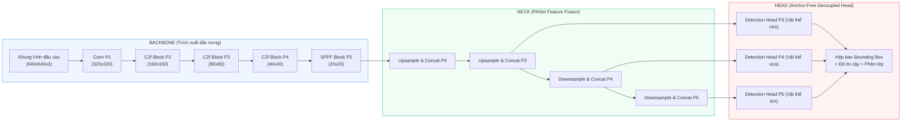

---

### 🖼️ Hình 2.2: Sơ đồ 468 Điểm mốc 3D Khuôn mặt MediaPipe Face Mesh & Tọa độ Mắt/Miệng
* **Vị trí trong báo cáo:** Mục 2.2 (Chỉ số sinh trắc học và thuật toán DMS).
* **Mô tả nội dung:** Bản vẽ cấu trúc 468 điểm mốc trên khuôn mặt tài xế, phóng to chi tiết 6 điểm mốc của mắt trái (p1, p2, p3, p4, p5, p6) dùng tính EAR và 8 điểm mốc môi (m1 đến m8) dùng tính MAR.
* **Mã nguồn vẽ trên draw.io / Mermaid:**
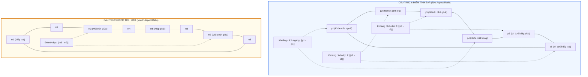
* **Quy tắc chú thích không che khuất:** Các đường kích thước (||p2-p6||, ||p1-p4||) đặt nét đứt và nằm bên ngoài đường bao của mắt, các điểm số p1..p6 đặt lệch góc 45 độ, không đè lên con ngươi.

---

### 🖼️ Hình 2.3: Đồ thị Sinh trắc học Biến thiên EAR và MAR theo Thời gian
* **Tệp ảnh đã tạo:** `report_assets/fig_ear_mar_clean.png` (sắc nét, không che chữ).
* **Mô tả nội dung:** Biểu đồ sóng 2 hàng song song. Hàng 1 thể hiện chỉ số mở mắt EAR tụt xuống dưới ngưỡng 0.20 khi nhắm mắt $> 1.5$s. Hàng 2 thể hiện chỉ số MAR vượt ngưỡng 0.65 khi ngáp ngủ.
* **Quy tắc chú thích:** Hộp cảnh báo đặt ở góc trái/phải thoáng, mũi tên chỉ dẫn màu đỏ trỏ đúng vào đáy sóng mà không đè lên các điểm dữ liệu.

---

### 🖼️ Hình 2.4: Sơ đồ Biến đổi Phối cảnh Homography chuyển ảnh 2D sang Mặt đường 3D
* **Vị trí trong báo cáo:** Mục 2.3 (Biến đổi phối cảnh phẳng).
* **Mô tả nội dung:** Trực quan hóa góc nhìn phối cảnh camera nghiêng trên kính lái (Perspective View) với 4 điểm neo trên làn đường biến đổi thành góc nhìn thẳng từ trên xuống (Bird's Eye View - BEV) bằng ma trận $H_{3 \times 3}$.
* **Mã nguồn vẽ trên draw.io / Mermaid:**
```mermaid
flowchart LR
    subgraph CAM["KHUNG ẢNH 2D (Perspective View)"]
        A["Điểm tiếp xúc bánh xe\nTọa độ pixel: (u, v)"]
        L1["Vạch làn trái (Hội tụ)"]
        L2["Vạch làn phải (Hội tụ)"]
        VP["Điểm ảo chân trời (Vanishing Point)"]
    end

    H["MA TRẬN HOMOGRAPHY H\n[Xw, Yw, 1]^T = H * [u, v, 1]^T\n(Ground Calibration Matrix)"]

    subgraph WORLD["MẶT ĐƯỜNG THỰC TẾ 3D (Bird's Eye View)"]
        W1["Tọa độ thực: (X_mét, Y_mét)"]
        P1["Hai vạch kẻ đường song song thực tế"]
        P2["Đo cự ly thực tế tới xe trước (mét)"]
        P3["Đo độ dịch chuyển Δd / Δt -> Vận tốc (km/h)"]
    end

    CAM --> H --> WORLD
    style CAM fill:#EFF6FF,stroke:#3B82F6;
    style H fill:#FEF3C7,stroke:#D97706,stroke-width:2px;
    style WORLD fill:#ECFDF5,stroke:#059669;
```

---

### 🖼️ Hình 2.5: Đồ thị Phân vùng Thời gian Va chạm Tiềm ẩn (TTC Dynamic Safety Zones)
* **Tệp ảnh đã tạo:** `report_assets/fig_ttc_zones_clean.png`.
* **Mô tả nội dung:** Đồ thị quan hệ giữa khoảng cách tới xe trước ($d$) và thời gian va chạm ước tính ($TTC = d / \Delta v$). Phân rõ 3 vùng màu: Đỏ (Nguy cấp $TTC \le 1.5$s), Vàng (Chú ý $1.5 < TTC \le 3.0$s), Xanh lá (An toàn $TTC > 3.0$s).

---

### 🖼️ Hình 2.6: Đồ thị Quy định Khoảng cách An toàn theo Thông tư 31/2019/TT-BGTVT
* **Tệp ảnh đã tạo:** `report_assets/fig_safe_distance_clean.png`.
* **Mô tả nội dung:** Đồ thị bậc thang thể hiện cự ly tối thiểu bắt buộc ứng với các dải tốc độ: $\le 60\text{km/h}$ (chủ động $\ge 35$m), $60-80\text{km/h}$ (55m), $80-100\text{km/h}$ (70m), $100-120\text{km/h}$ (100m). Đường nét đứt màu đỏ thể hiện hệ số $1.30\times$ khi trời mưa đường trơn.

---

### 🖼️ Hình 2.7: Quy chuẩn Cấu trúc Biển số xe Việt Nam (Thông tư 24/2023/TT-BCA)
* **Vị trí trong báo cáo:** Mục 2.4 (Quy chuẩn biển số xe cơ giới).
* **Mô tả nội dung:** Bản vẽ phân giải cấu trúc 2 định dạng biển số xe: Biển ô tô dài (1 hàng) và Biển ô tô vuông / xe máy (2 hàng).
* **Mã nguồn vẽ trên draw.io / Mermaid:**
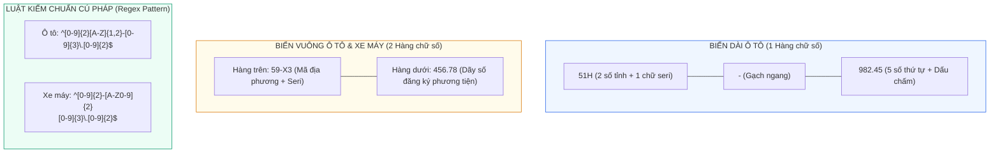

---

## CHƯƠNG 3: PHÂN TÍCH YÊU CẦU & KIẾN TRÚC

### 🖼️ Hình 3.1: Sơ đồ Kiến trúc Tổng thể 4 Tầng của Nền tảng TrafficGuard
* **Tệp ảnh đã tạo:** `report_assets/fig_system_architecture.png`.
* **Mã nguồn vẽ lại vector trên draw.io / Mermaid (Cực kỳ sắc nét):**
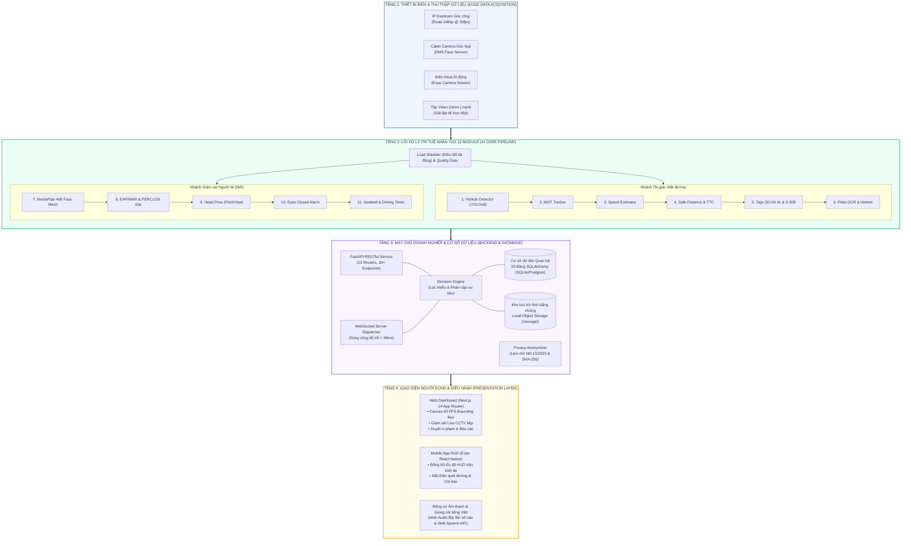

---

### 🖼️ Hình 3.2: Sơ đồ Ca sử dụng Tổng thể (Use-Case Diagram)
* **Vị trí trong báo cáo:** Mục 3.2 (Mô hình ca sử dụng).
* **Mô tả nội dung:** 3 tác nhân (Admin Doanh nghiệp, Điều độ viên, Tài xế) tương tác với các Use-Case của hệ thống.
* **Mã nguồn vẽ trên draw.io / Mermaid:**
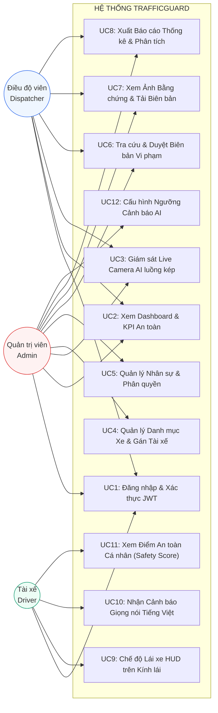

---

### 🖼️ Hình 3.3: Sơ đồ Luồng Dữ liệu (Data Flow Diagram - DFD Cấp 1)
* **Vị trí trong báo cáo:** Mục 3.3 (Luồng dữ liệu hệ thống).
* **Mã nguồn vẽ trên draw.io / Mermaid:**
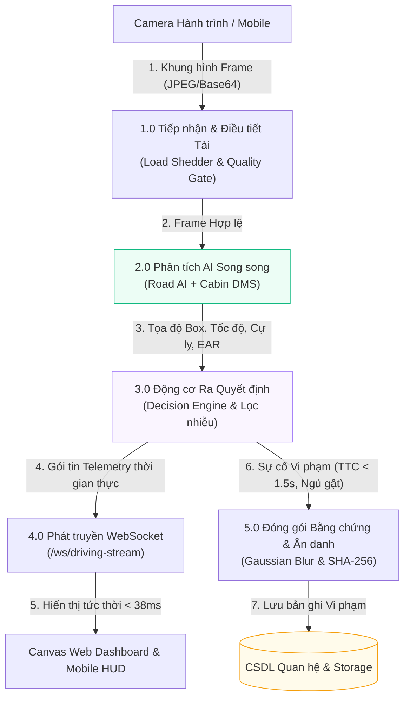

---

### 🖼️ Hình 3.4: Sơ đồ Quan hệ Thực thể Cơ sở Dữ liệu (ERD - 15 Bảng)
* **Vị trí trong báo cáo:** Mục 3.4 (Thiết kế cơ sở dữ liệu quan hệ).
* **Mã nguồn vẽ trên draw.io / Mermaid:**
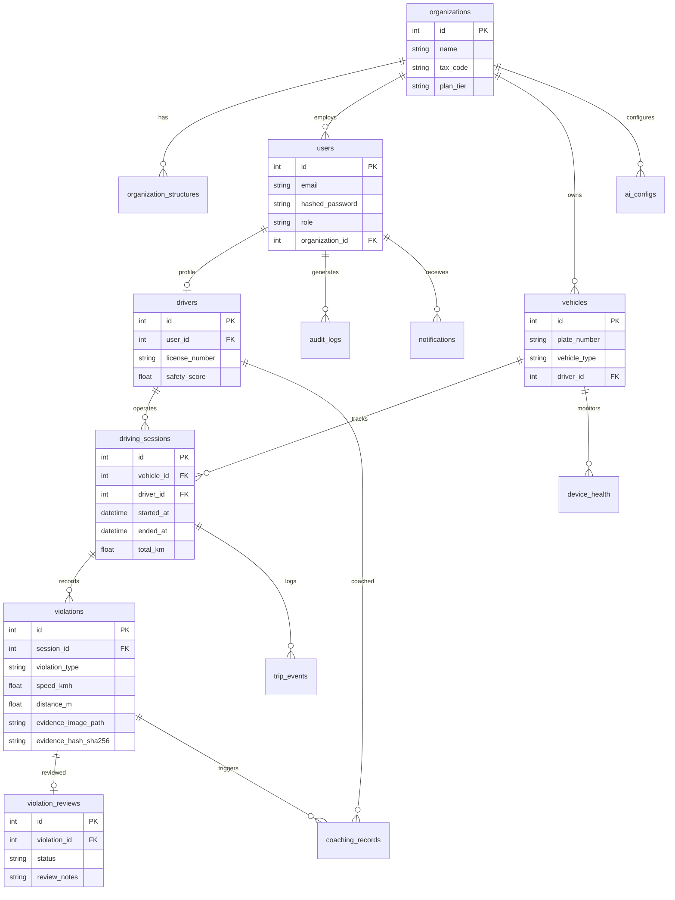

---

## CHƯƠNG 4: 12 MODULE TRÍ TUỆ NHÂN TẠO (AI PIPELINE)

### 🖼️ Hình 4.1: Sơ đồ Luồng Xử lý Song song 2 Nhánh (Dual-Stream Pipeline)
* **Vị trí trong báo cáo:** Mục 4.1 (Kiến trúc tổng thể Pipeline AI).
* **Mã nguồn vẽ trên draw.io / Mermaid:**
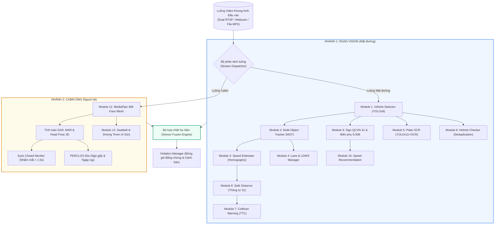

---

### 🖼️ Hình 4.2: Sơ đồ Thuật toán Bám vết Đa đối tượng (MOT IoU + Hungarian)
* **Vị trí trong báo cáo:** Mục 4.2.2 (Module bám vết đa đối tượng).
* **Mã nguồn vẽ trên draw.io / Mermaid:**
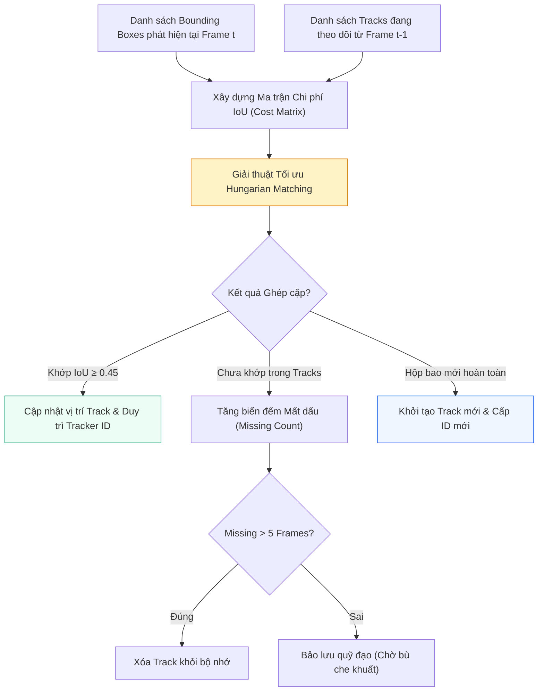

---

### 🖼️ Hình 4.3: Sơ đồ Thuật toán Ước tính Vận tốc Xe qua Ma trận Homography
* **Vị trí trong báo cáo:** Mục 4.2.3 (Module ước tính vận tốc).
* **Mã nguồn vẽ trên draw.io / Mermaid:**
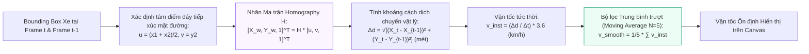

---

### 🖼️ Hình 4.4: Sơ đồ Quy trình 3 Giai đoạn Nhận diện Biển số xe Việt Nam
* **Vị trí trong báo cáo:** Mục 4.2.5 (Module nhận diện biển số xe).
* **Mã nguồn vẽ trên draw.io / Mermaid:**
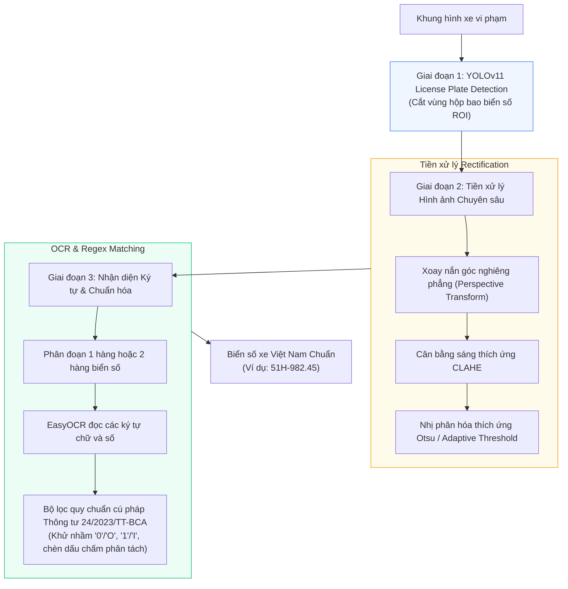

---

### 🖼️ Hình 4.5: Sơ đồ Thuật toán Khử trùng lặp Cảnh báo Mũ bảo hiểm (Deduplication)
* **Vị trí trong báo cáo:** Mục 4.2.6 (Module kiểm tra mũ bảo hiểm).
* **Mô tả:** Giữ cho hệ thống không bị bắn lặp lại hàng trăm cảnh báo cho cùng 1 người đi xe máy.
* **Mã nguồn vẽ trên draw.io / Mermaid:**
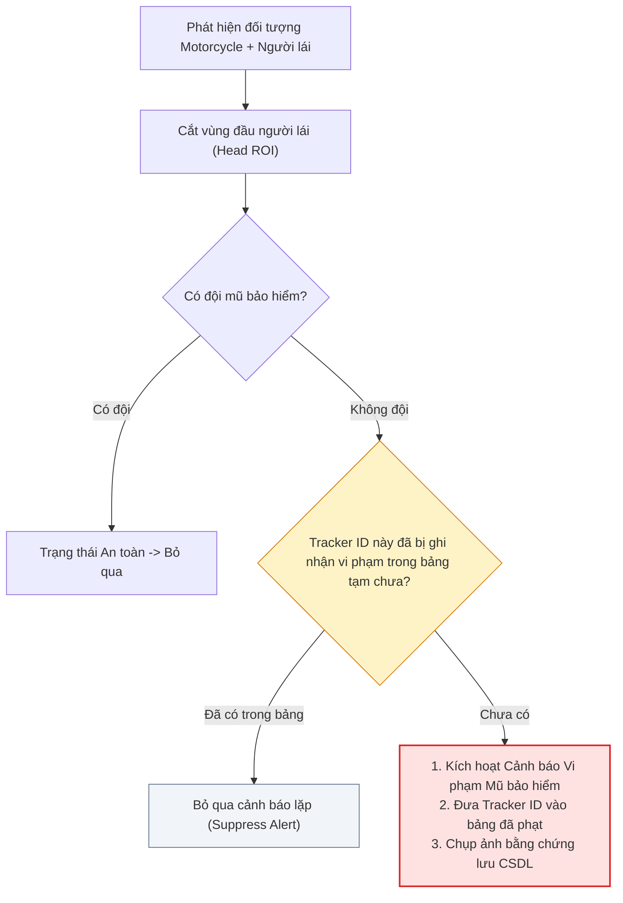

---

### 🖼️ Hình 4.6: Sơ đồ Thuật toán Cắt lát Tỷ lệ Cột Biển báo (Pole Proportional Slicing)
* **Tệp ảnh đã tạo:** `report_assets/fig_pole_slicing_clean.png`.
* **Mô tả chi tiết & Quy tắc không che khuất:** 
  - Ảnh minh họa cột biển báo có 3 biển đặt dọc: Biển chính $P.124b$ (trên cùng), Biển phụ $S.508$ (giữa), Biển cảnh báo $W.245a$ (dưới cùng).
  - **Quy tắc chú thích:** 3 hộp mô tả giải thuật được kéo hẳn sang vùng nền trắng phía bên phải (`x = 48..96`), sử dụng 3 đường mũi tên chỉ sang 3 biển báo bên trái. **Tuyệt đối không đè chữ lên mặt biển báo!**

---

### 🖼️ Hình 4.7: Mẫu Bộ Dữ liệu Biển báo Giao thông QCVN 41:2019
* **Tệp ảnh đã tạo:** `report_assets/fig_qcvn_signs_sample.png`.
* **Mô tả nội dung:** Lưới $2 \times 4$ hiển thị 8 mẫu biển báo giao thông sắc nét chuẩn QCVN 41: $P.101$ (Đường cấm), $P.102$ (Cấm đi ngược chiều), $P.103a$ (Cấm ô tô), $P.104$ (Cấm mô tô), $P.105$ (Cấm ô tô và mô tô), $DP.135$ (Hết mọi lệnh cấm), $I.401$ (Bắt đầu đường ưu tiên), $I.402$ (Hết đường ưu tiên).

---

### 🖼️ Hình 4.8: Sơ đồ Máy Trạng thái Giám sát Ngủ gật Cabin (DMS State Machine)
* **Vị trí trong báo cáo:** Mục 4.4.1 & 4.4.2 (Giám sát buồn ngủ & nhắm mắt kéo dài).
* **Mã nguồn vẽ trên draw.io / Mermaid:**
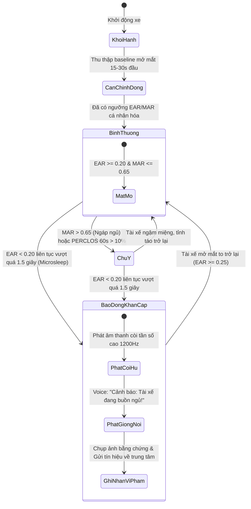

---

### 🖼️ Hình 4.9: Sơ đồ Bộ đệm Khung hình Trượt (Rolling Buffer) & Đóng gói Bằng chứng
* **Vị trí trong báo cáo:** Mục 4.4.4 (Module quản lý lưu vết vi phạm).
* **Mô tả:** Cơ chế lưu 5 frames trước và 5 frames sau thời điểm xảy ra sự cố vi phạm.
* **Mã nguồn vẽ trên draw.io / Mermaid:**
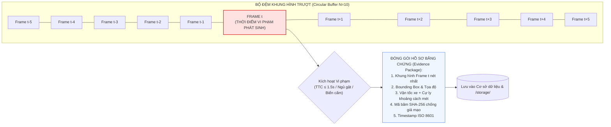

---

## CHƯƠNG 5: MÁY CHỦ BACKEND & CSDL FASTAPI

### 🖼️ Hình 5.1: Sơ đồ Tuần tự (Sequence Diagram): Xác thực JWT & Phân quyền RBAC
* **Vị trí trong báo cáo:** Mục 5.2 (Xác thực và phân quyền RBAC).
* **Mã nguồn vẽ trên draw.io / Mermaid:**
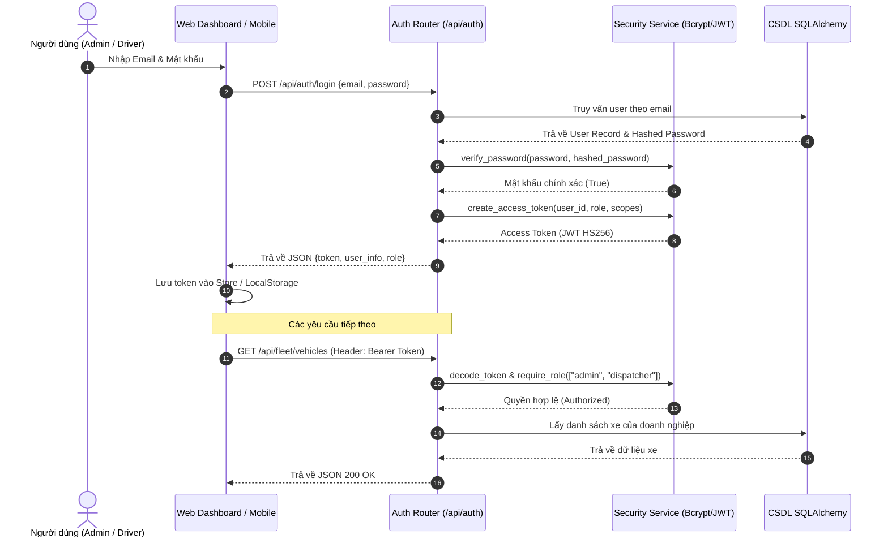

---

### 🖼️ Hình 5.2: Sơ đồ Tuần tự: Truyền thông WebSocket Streaming Thời gian thực
* **Vị trí trong báo cáo:** Mục 5.4 (Giao thức truyền thông WebSocket).
* **Mã nguồn vẽ trên draw.io / Mermaid:**
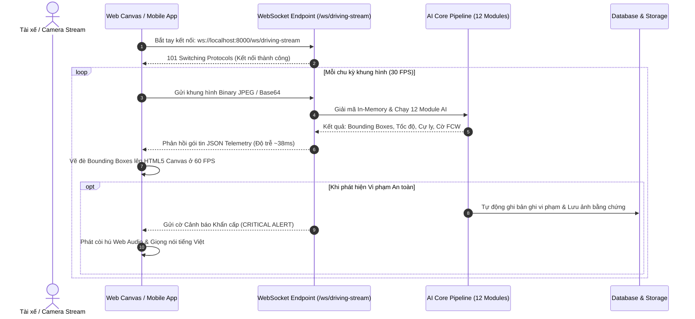

---

### 🖼️ Hình 5.3: Sơ đồ Cây Phân cấp Ưu tiên Cảnh báo (Decision Engine)
* **Vị trí trong báo cáo:** Mục 5.5.1 (Động cơ ra quyết định cảnh báo).
* **Mã nguồn vẽ trên draw.io / Mermaid:**
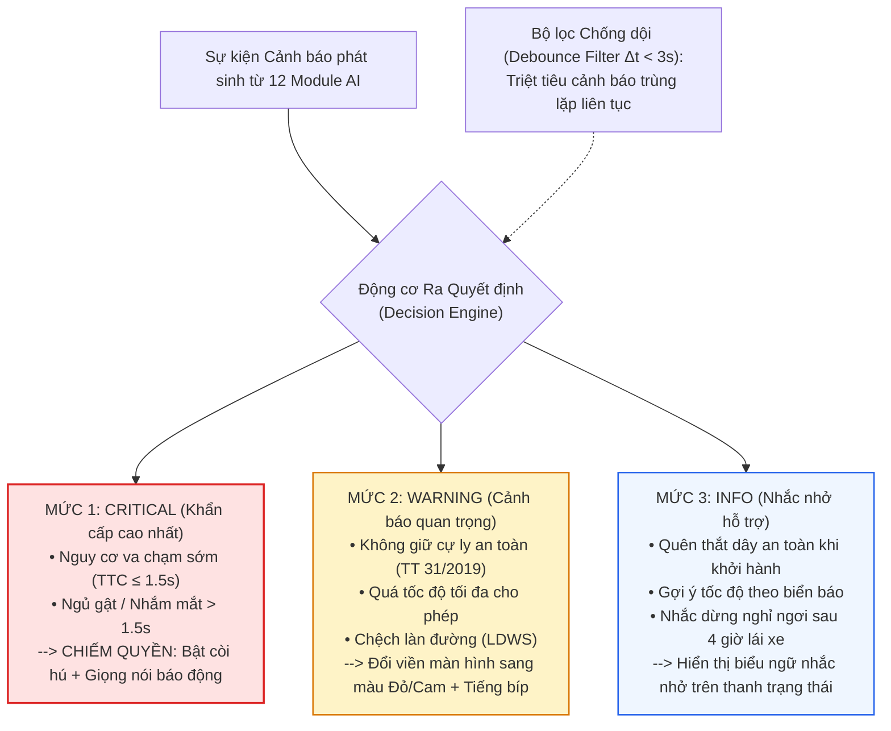

---

### 🖼️ Hình 5.4: Sơ đồ Quy trình Làm mờ Ẩn danh & Tạo Chữ ký Băm SHA-256 (NĐ 13/2023)
* **Vị trí trong báo cáo:** Mục 5.5.2 (Bảo vệ dữ liệu cá nhân theo Nghị định 13/2023/NĐ-CP).
* **Mã nguồn vẽ trên draw.io / Mermaid:**
```mermaid
flowchart LR
    Raw["Ảnh Bằng chứng Gốc\n(Chụp lúc xe vi phạm)"] --> Detect["Phát hiện vùng nhạy cảm:\n1. Mặt người đi bộ xung quanh\n2. Biển số xe khác không vi phạm"]
    Detect --> Blur["Áp dụng Gaussian Blur (k=31)\nLàm mờ hoàn toàn vùng nhạy cảm\n(Tuân thủ NĐ 13/2023/NĐ-CP)"]
    Blur --> AnonImg["Ảnh Bằng chứng Đã Ẩn danh"]
    AnonImg --> SHA["Thuật toán Băm Mật mã SHA-256\nhash = sha256(anon_image_bytes)"]
    SHA --> HashCode["Mã băm SHA-256 (Tamper-proof hash)\nVí dụ: 8f4e2...a9b1"]
    AnonImg --> Store[("/storage/evidence_xyz.jpg")]
    HashCode --> DB[("CSDL: Bảng violations\n(Lưu trường evidence_hash_sha256)")]

    style Blur fill:#FEF3C7,stroke:#D97706;
    style SHA fill:#ECFDF5,stroke:#059669;
```

---

## CHƯƠNG 6: GIAO DIỆN WEB DASHBOARD & MOBILE APP

### 🖼️ Hình 6.1: Bản vẽ Bố cục Giao diện Trung tâm Điều hành (`/dashboard`)
* **Vị trí trong báo cáo:** Mục 6.2.2 (Màn hình trung tâm điều hành).
* **Mô tả cấu trúc bố cục (Wireframe):**
  - **Hàng 1 (Header):** Logo TrafficGuard, Bộ chọn chi nhánh đội xe, Thông tin tài khoản đăng nhập.
  - **Hàng 2 (4 Thẻ KPI Metric):** 
    - Thẻ 1: *Fleet Safety Score* (Điểm trung bình an toàn toàn đội xe: 92/100, viền xanh).
    - Thẻ 2: *Active Journeys* (Số xe đang chạy trực tuyến: 14 xe).
    - Thẻ 3: *Total Violations* (Số vi phạm hôm nay: 8 vụ).
    - Thẻ 4: *Operating Hours* (Tổng giờ vận hành an toàn: 156 giờ).
  - **Hàng 3 (Hai cột chính):**
    - Cột trái (60%): Biểu đồ diện tích xu hướng vi phạm theo 24 giờ trong ngày.
    - Cột phải (40%): Danh sách các cảnh báo vi phạm khẩn cấp mới nhất kèm ảnh chụp thu nhỏ.

---

### 🖼️ Hình 6.2: Bản vẽ Bố cục Màn hình Giám sát Trực tuyến Live Camera Kép (`/live`)
* **Vị trí trong báo cáo:** Mục 6.2.3 (Màn hình giám sát trực tuyến).
* **Mô tả cấu trúc bố cục & Quy tắc chống che khuất:**
  - **Khung xem chính (Road Camera Viewport 16:9):** Hiển thị video mặt đường.
    - *Vị trí Bounding Box:* Vẽ đường viền 2px ôm sát xe. 
    - *Vị trí Nhãn thông tin:* Đặt ở góc trên bên trái của Bounding Box (ví dụ: `Xe con #4 | 54 km/h | 28m`), nền bán trong suốt để không che lấp vạch kẻ đường bên dưới.
    - *Thanh Telemetry (Dưới chân video):* Cố định ở đáy video, hiển thị Tốc độ hiện tại ($52\text{ km/h}$), Cự ly an toàn khuyến nghị ($35\text{m}$), Biển báo tốc độ giới hạn ($60\text{ km/h}$).
  - **Khung phụ góc trên bên phải (Cabin DMS Viewport 4:3):** Hiển thị khuôn mặt tài xế.
    - 468 điểm mốc hiển thị dạng chấm xanh mờ (alpha = 0.4), không che mắt tài xế.
    - Góc trên khung hình cabin hiển thị chỉ số: `EAR: 0.31 | MAR: 0.14 | Tỉnh táo`.
  - **Thanh cảnh báo nguy cấp (Critical Alert Bar):** Nằm ở phía trên cùng của trang web, chỉ xuất hiện khi có sự cố, không chèn đè lên video.

---

### 🖼️ Hình 6.3: Biểu đồ Cơ cấu Các loại Lỗi Vi phạm An toàn Giao thông Toàn Đội xe
* **Tệp ảnh đã tạo:** `report_assets/fig_violation_distribution_clean.png`.
* **Mô tả:** Biểu đồ tròn Donut Chart với chú giải (legend) được xếp ngay ngắn ở cột bên phải ngoài biểu đồ, không có nhãn chữ đè lên các lát cắt.

---

### 🖼️ Hình 6.4: Bản vẽ Bố cục Modal Soi Ảnh Bằng chứng Vi phạm Chi tiết (`/violations`)
* **Vị trí trong báo cáo:** Mục 6.2.4 (Màn hình quản lý hồ sơ vi phạm).
* **Mô tả:** Khi bấm vào 1 bản ghi vi phạm trong danh sách, modal hiện lên chia làm 2 cột:
  - Cột trái: Ảnh chụp bằng chứng độ phân giải cao trích xuất từ AI, hiển thị rõ biển số xe và cự ly đo đạc lúc vi phạm.
  - Cột phải: Bảng thông số chi tiết (Thời gian, Vận tốc lúc vi phạm, Loại lỗi, Tài xế phụ trách, Mã băm SHA-256) cùng hai nút bấm lớn: *Phê duyệt biên bản* (Xanh) và *Bác bỏ cảnh báo* (Xám).

---

### 🖼️ Hình 6.5: Bản vẽ Bố cục Màn hình Chẩn đoán Hiệu năng 12 Module AI (`/ai-status`)
* **Vị trí trong báo cáo:** Mục 6.2.8 (Màn hình chẩn đoán 12 module AI).
* **Mô tả:** Bảng lưới giám sát 12 thẻ (Grid 3x4). Mỗi thẻ đại diện cho 1 module AI hiển thị: Tên module, Tên model sử dụng, Trạng thái hoạt động (Active - Xanh lá), Tốc độ FPS thực tế (28 - 32 FPS), và Độ trễ tính toán (ms).

---

### 🖼️ Hình 6.6: Bản vẽ Bố cục Màn hình Lái xe HUD trên Điện thoại (`mobile-app/app/drive.tsx`)
* **Vị trí trong báo cáo:** Mục 6.4 (Hiện thực hóa ứng dụng di động).
* **Mô tả giao diện:**
  - Nền đen hoàn toàn (AMOLED Black) giúp hiển thị tương phản cao phản quang lên kính lái xe ban đêm.
  - Đồng hồ số lớn ở trung tâm: Hiển thị vận tốc thực tế (`68 km/h`).
  - Phía trên đồng hồ: Icon biển báo tốc độ giới hạn hiện tại (`80 km/h`).
  - Phía dưới đồng hồ: Thanh chỉ báo cự ly an toàn (`Khoảng cách: 58m | AN TOÀN`).
  - Viền ngoài toàn màn hình: Đổi màu theo trạng thái (Xanh lá: An toàn, Vàng: Chú ý, Đỏ nhấp nháy: Nguy hiểm).

---

### 🖼️ Hình 6.7: Sơ đồ Máy Trạng thái Hành trình Di động (tripStateMachine.ts)
* **Vị trí trong báo cáo:** Mục 6.4 (Quản lý vòng đời chuyến đi trên di động).
* **Mã nguồn vẽ trên draw.io / Mermaid:**
```mermaid
stateDiagram-v2
    [*] --> ChoKhoiHanh: Tài xế mở màn hình Drive
    ChoKhoiHanh --> DangDiChuyen: Vận tốc v > 5 km/h trong 5 giây
    DangDiChuyen --> TamDungDoXe: Vận tốc v = 0 km/h kéo dài > 3 phút
    TamDungDoXe --> DangDiChuyen: Xe lăn bánh trở lại (v > 5 km/h)
    TamDungDoXe --> KetThucChuyenDi: Tài xế bấm nút "Kết thúc chuyến"
    DangDiChuyen --> KetThucChuyenDi: Tài xế bấm nút "Kết thúc chuyến"
    KetThucChuyenDi --> ManHinhTongKet: Chuyển sang trip-summary.tsx
    ManHinhTongKet --> [*]: Tính điểm an toàn & Lưu vào CSDL
```

---

## CHƯƠNG 7: KIỂM THỬ, THỰC NGHIỆM & HIỆU NĂNG

### 🖼️ Hình 7.1: Biểu đồ Đánh giá Độ chính xác 5 Tác vụ AI Cốt lõi
* **Tệp ảnh đã tạo:** `report_assets/fig_ai_benchmark_accuracy_clean.png`.
* **Mô tả:** Biểu đồ cột nhóm so sánh mAP@0.5, Precision, Recall cho 5 tác vụ AI: Phát hiện xe (94.2%), Biển báo QCVN (95.8%), Biển số xe OCR (91.5%), Giám sát ngủ gật (96.0%), Mũ bảo hiểm (93.8%). Các nhãn số nằm thoải mái phía trên cột, không bị che khuất.

---

### 🖼️ Hình 7.2: Biểu đồ Đo lường Độ trễ Suy luận Từng Module AI
* **Tệp ảnh đã tạo:** `report_assets/fig_module_latency_clean.png`.
* **Mô tả:** Biểu đồ thanh ngang thể hiện thời gian thực thi (ms) của từng module, tổng thời gian toàn bộ pipeline đạt 38ms, thỏa mãn tiêu chuẩn an toàn giao thông $< 50$ms.

---

### 🖼️ Hình 7.3: Ảnh Chụp Thực nghiệm Kết quả Nhận diện Cụm 3 Biển báo trên Cột
* **Tệp ảnh đã tạo:** `report_assets/fig_pole_slicing_clean.png`.
* **Mô tả chi tiết:** Minh họa kết quả nhận diện chính xác 3 biển báo trên cùng 1 cột trong ảnh camera hành trình thực tế: Biển cấm quay đầu và rẽ trái $P.124b$ (98%), Biển phụ thời gian $S.508$ từ 6h-22h (95%), và Biển cảnh báo đi chậm $W.245a$ (94%).

---

## CHƯƠNG 8: TRIỂN KHAI PRODUCTION & PHÁP LÝ

### 🖼️ Hình 8.1: Sơ đồ Luồng Khởi chạy Tự động hóa bằng Script 1-Chạm (`start_project.bat`)
* **Vị trí trong báo cáo:** Mục 8.1 (Quy trình đóng gói và triển khai).
* **Mã nguồn vẽ trên draw.io / Mermaid:**
```mermaid
flowchart TD
    User["Người dùng Kích đúp tệp:\nstart_project.bat"] --> Split{"Script tự động tách\n2 Luồng Tiến trình"}
    
    Split -->|"Cửa sổ CMD 1"| B1["Kích hoạt môi trường ảo Python:\n.\\venv\\Scripts\\python.exe"]
    B1 --> B2["Khởi chạy Máy chủ Uvicorn FastAPI:\nuvicorn backend.app.main:app --port 8000"]
    B2 --> B3["Máy chủ API & AI sẵn sàng tại:\nhttp://localhost:8000 (Swagger: /docs)"]
    
    Split -->|"Cửa sổ CMD 2"| F1["Di chuyển vào thư mục web-app:\ncd web-app"]
    F1 --> F2["Khởi chạy Máy chủ Next.js 14:\nnpm run dev (Port 3000)"]
    F2 --> F3["Giao diện Web sẵn sàng tại:\nhttp://localhost:3000"]

    B3 & F3 --> Ready["HỆ THỐNG TRAFFICGUARD HOẠT ĐỘNG HOÀN TOÀN\n(Đồng bộ dữ liệu thời gian thực qua WebSocket)"]

    style User fill:#FEF3C7,stroke:#D97706,stroke-width:2px;
    style B3 fill:#EFF6FF,stroke:#2563EB;
    style F3 fill:#ECFDF5,stroke:#059669;
    style Ready fill:#FAF5FF,stroke:#8B5CF6,stroke-width:2px;
```

---

### 🖼️ Hình 8.2: Sơ đồ Cấu trúc Cây Thư mục Dự án Sau khi Dọn dẹp Sạch Chuẩn Công nghiệp
* **Vị trí trong báo cáo:** Mục 8.2 (Chiến lược dọn dẹp Clean Architecture).
* **Mã nguồn vẽ trên draw.io / Mermaid:**
```mermaid
flowchart TD
    Root["d:\\Smart Driving Assistant (Thư mục Gốc)"]
    
    Root --> BE["backend/\n• app/ (api, core, crud, models_db, schemas, services)\n• tests/ (Kiểm thử API & WebSocket)"]
    Root --> AI["ai_engine/\n• modules/ (12 Modules AI độc lập)\n• models/ (Checkpoints YOLO & MediaPipe)\n• plate/ (Nhận diện biển số xe VN)"]
    Root --> WEB["web-app/\n• src/app/ (9 Trang Dashboard Next.js 14)\n• src/components/ (Dual Camera Canvas, Alert Bar)\n• src/hooks/ (WebSocket driving streams)"]
    Root --> MOB["mobile-app/\n• app/ (Màn hình HUD drive.tsx & trip-summary)\n• lib/ (Còi báo động & State machine)"]
    Root --> BAT["start_project.bat (Launcher 1-chạm)"]
    Root --> TESTS["tests/\n• unit/ (Kiểm thử tự động PyTest 90/90)\n• verify_*.py (Bộ kiểm thử hồi quy nghiệp vụ)"]

    style Root fill:#F8FAFC,stroke:#334155,stroke-width:2px;
    style BE fill:#EFF6FF,stroke:#3B82F6;
    style AI fill:#ECFDF5,stroke:#10B981;
    style WEB fill:#FFFBEB,stroke:#F59E0B;
    style MOB fill:#FAF5FF,stroke:#8B5CF6;
```

---

# 📌 TÓM TẮT HƯỚNG DẪN SỬ DỤNG CHO BÁO CÁO 90 TRANG

1. **Cách vẽ sơ đồ Diagram trong 10 giây:**
   - Truy cập [https://app.diagrams.net/](https://app.diagrams.net/).
   - Chọn menu: `Arrange` $\rightarrow$ `Insert` $\rightarrow$ `Advanced` $\rightarrow$ `Mermaid`.
   - Dán toàn bộ khối mã code Mermaid tương ứng ở trên vào và bấm **Insert**.
   - Sơ đồ sẽ được vẽ tự động với các khối màu sắc hài hòa, đường nét vuông vức, không bao giờ bị đè chữ. Sau đó bạn chọn `File -> Export as -> PNG (hoặc SVG)` để chèn vào báo cáo.
2. **Cách chèn các biểu đồ số liệu thực nghiệm:**
   - Toàn bộ 7 biểu đồ số liệu đã được tự động sinh sẵn với độ phân giải cao 300 DPI trong thư mục:
     `d:\Smart Driving Assistant\report_assets\`
   - Bạn chỉ cần chèn trực tiếp các tệp ảnh `.png` sạch sẽ này vào đúng các mục tương ứng trong báo cáo.
3. **Cách bố trí ảnh chụp màn hình chống che khuất:**
   - Giữ nguyên tỷ lệ 16:9 của khung video camera.
   - Luôn đặt bảng số liệu (Telemetry) cố định ở thanh đáy hoặc thanh đỉnh của khung hình, không để trôi nổi vào giữa làn đường hoặc tâm xe.
